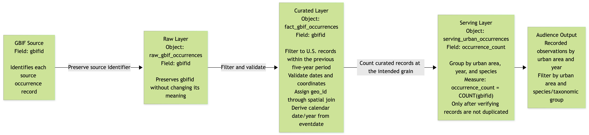

# P1 — Grain, Model, History & Pipeline Plan

## 1. Establish the question and check the source

### Audience, need, and analytical question

This product would be valuable for conservationists and urban planners looking to restore natural pockets of biodiversity within urban areas. 

A problem this audience might face is not being able to connect their jurisdiction to large-scale and current biodiversity study data. This product could bridge a gap between large biodiversity datasets and the local planners who are deciding conservation strategies. It’s possible a tool like this could lead to better focused choices that promote greater biodiversity.

The primary analytical question this model seeks to answer is:
- What species observations have been made within urban areas over time?
An specific supporting question that this model would support is:
- What are the 50 least observed species in Chicago, IL?

### P0 changes and feedback addressed

The primary change I've made based on P0 feedback is to the scope of analytical questions. I will be focusing the product on recorded observations rather than claims of population decline or migration priority. 

### Source profile

#### GBIF Biodiversity Data
| Item | Source-supported finding |
|:---:|:---:|
| Source object(s) | BigQuery gbif public dataset's occurrences table |
| BigQuery identifier(s) | bigquery-public-data.gbif.occurrences |
| Source row meaning | One row is one species identification observation - evidence of the occurrence of a species (or other taxon) at a particular place on a specified date. |
| Row count | 3,729,438,201 |
| Date coverage | 1500-01-01 00:00:00 UTC to 2026-08-28 00:08:00 UTC |
| Candidate fact identifier | gbifid |
| Relevant limitation | This table is a combination of many different datasets, from historic museum observations to citizen science apps, so the thoroughness, completion, and accuracy may vary widely within the dataset. Inconsistencies may come up with aggregations that include different origin datasets. Additionally, if the table is limited to one public reporting set, it's still likely that observer effort will distort occurrence counts. |

#### Census Urban Areas
| Item | Source-supported finding |
|:---:|:---:|
| Source object(s) | BigQuery geo_us_boundaries dataset's urban_areas table |
| BigQuery identifier(s) | bigquery-public-data.geo_us_boundaries.urban_areas |
| Source row meaning | One row represents one polygon around an urban area in the US |
| Row count | 3,601 |
| Date Coverage | no date/time data provided |
| Candidate fact identifier | geo_id |
| Relevant limitation | I will need to explore the geo capabilities of BigQuery to see if these geo columns can be used with the other dataset’s coordinate points |

### Proposed grain and observed check

Profiling SQL: [`sql/p1_source_profile.sql`](../sql/p1_source_profile.sql)

#### GBIF Biodiversity Data
**Proposed grain:** One row is one species identification observation - evidence of the occurrence of a species (or other taxon) at a particular place on a specified date.

**Expected counts:** 3,729,438,201

**Observed counts:** 3729438201

**Conclusion:** The gbifid is the key for the gbif table. I investigated a possible combination of the taxonkey, decimallatitude, decimallongitude, eventdate, collectioncode, catalognumber columns to try to define what composes the grain of the raw data further. These were the results:
| source_rows | rows_with_null_key_component | repeated_key_groups |
|:-----------:|:----------------------------:|:-------------------:|
| 3729438201  | 1372949073                   | 4002218             |

Based on these results, I've concluded that it would be difficult to establish exactly what combination of observations composes the grain of the raw table, and the exact grain defining columns would be easier to determine after the raw data is processed further (eg. limiting countrycode = US, basisofrecord = HUMAN_OBSERVATION)

#### Census Urban Areas
**Proposed grain:** One row represents one polygon around an urban area in the US.

**Expected counts:** 3,601

**Observed counts:** 3601

**Conclusion:** Aggregate functions can't be performed on geometry columns, but using urban_area_code as a proxy for urban_area_geom shows that there are the same non_null code entries as there are table rows.

#### Comments on grain and linking these datasets
The census urban area table was last updated in 2019, so it is safe to assume these urban boundaries are based on the 2010 census. According to the [2010 Census Urban and Rural Classification and Urban Area Criteria](https://www.census.gov/programs-surveys/geography/guidance/geo-areas/urban-rural/2010-urban-rural.html) the urban area shapes follow certain rules to ensure the boundaries are mutually exclusive, don't intersect with any other urban area, and are merged into one area if territories touch. Based on this information, it would be appropriate to say that one species observation's geographic point should only correspond to one urban area, if any.

## 2. Define the model and predict a history consequence

### Business process, fact type, and grain

The business process would be species observations made in urban areas. This model's fact table is a transaction type because each observation is recorded as it occurs. The model grain is one row represents one observation (gbifid) made in the United States within the last five years.

I will be choosing the biodiversity data set to be the central fact table. I will be limiting the biodiversity data to that within the U.S. in the last five years. This biodiversity data will then connect to the urban area table through a spatial relationship and assign an urban area code to the fact table during processing.

### Model diagram

### Question-to-model mapping

The primary analytical question—“What species observations have been made within urban areas over time" is answered by the FACT_GBIF_OCCURRENCE fact table, which contains one row per GBIF occurrence record identified by gbifid. Through this fact table, we can take a count of occurrence records and the count of distinct recorded species using specieskey. Taxonomic attributes such as species, genus, family, and kingdom will support species-level analysis and taxonomic filtering.

The DIM_URBAN_AREA dimension provides the urban-area name and geographic boundary. GBIF occurrence coordinates will be spatially joined to the Census urban-area polygons to assign observations to urban areas. 

The DIM_DATE dimension will provide calendar attributes derived from eventdate, allowing results to be grouped by year or month.

Filters on the data will restrict observations to the selected five-year period and U.S. study area, with an urban-area assignment for analyses comparing urban locations.

### Changing attributes and history

One value that may change over time with new census data would be the boundaries of urban areas. Changes to the urban_area_geom column may affect urban/rural the categorization of a historic observation. This would be a type 2 "meaningful" change and would require some type of version retention to be able to maintain the observation's urban categorization at the time of observation.

I'd propose a version_key column be added to the DIM_URBAN_AREA table which would be a compound of the geo_id with the census year (e.g. Phoenix-Mesa would be 69184.2010 ) and add an effective date range. This version_key is added to the FACT_GBIF_OCCURRENCE table to maintain the historic urban designation of the location of a species observation. The geo_id would still be the location's primary identifier - Phoenix_Mesa could still be found under 69184 through the years - but the version_key would become the DIM_URBAN_AREA table's new primary key.

### Behavior to implement or test by P3

The U.S. Census has published the 2020 urban area shape files. To test versioning and history, I could try to load the new shape file into my DIM_URBAN_AREA table following the versioning rules and see if it's effective date range changes the categorization of any observations. I noticed the Census Bureau also has already published corrections for Atlanta's 2020 boundaries. This could be used to test implementing type 1 corrections on this data set.

[Link to the most recent census data](https://www.census.gov/programs-surveys/geography/guidance/geo-areas/urban-rural.html)

## 3. Plan the build and its checks

### Raw, Curated, and Serving layers

| Layer | Planned object | Responsibility |
|:---:|:---:|:---:|
| Raw | raw_gbif_occurrences | Preserve the source GBIF occurrence fields that will be needed for further filtering and analysis|
| Raw | raw_census_urban_areas | Preserve the source census urban-area identifiers, names, and polygon geometries needed to assign occurrence points to urban areas. |
| Curated | fact_gbif_occurrences | Filter to eligible U.S. records in the selected five-year period, validate dates and coordinates, construct point geometries, and spatially assign each eligible occurrence to a Census urban area. Retain gbifid and the assigned urban-area version key. |
| Curated | dim_urban_area | Provide consistent urban-area attributes for grouping and filtering that has additional version_key column that supports versioning. |
| Serving | serving_urban_occurrences | Serving layer that provides aggregate species observation counts by urban area (geo_id), time (eventdate), and species (specieskey) |

### Preliminary run order and field path

1. Inspect and access the GBIF occurrence source and Census urban-area source on BigQuery.
2. Define the raw source objects, preserving the fields needed downstream and establishing the process to refresh and maintain raw table.
3. Filter the GBIF records to the U.S. and the selected five-year period then validate required dates, coordinates, and observation identification (require a specieskey, scientific name, or the like).
4. Convert valid longitude and latitude values in the GBIF set to geographic point geometries and spatially join them to the Census urban-area polygons. 
5. Check spatial assignment results and confirm that the join has not multiplied occurrence records.
6. Build the curated occurrence, urban-area, and date tables.
7. Create the serving layer query to aggregate species observation counts by urban area, time, and species.
8. Query the serving table to show examples for product - least observed species in Chicago in 2025; count of ground squirrels in anne arbor vs east lancing over time.

Tracing the field measure gbifid through the layers:

### Project risks and planned checks

| Risk | Planned check | Expected result | Layer or query |
|---|---|---|---|
| Grain or relationship risk: The coordinates provided for GBIF occurrences might not match the location information provided in fields like country and state code, meaning the observation counts my be different if the dataset is filtered down to just U.S observations and then joined to the urban areas table versus if all raw rows are joined to the geographic table. | I would create two duplicate small subset of observation data by filtering for a short period of time - just the last full month of observations - and filter one to countrycode = US. Then I would perform an inner join to the urban areas table for both observation subsets and compare the resulting observation counts. | In theory, both filtered and unfiltered tables should result with the same observation counts because the urban area boundaries are all within the U.S. but it may be possible that there are more observations in the unfiltered test if the countrycode column isn't filled out completely and accurately. | Curated-layer validation SQL after the spatial join. |
| Audience-result meaning risk: Differences in reporting effort or GBIF source dataset composition could make changes in occurrence counts look like changes in biodiversity. | I would aggregate observation counts by year and by available reporting attributes such as basisofrecord and datasetkey. Then I'd check the share of observations with missing specieskey, and compare annual record counts with distinct recorded species counts. | The results should show how the source composition and completeness vary over time. The audience output will need to label these measures as recorded observations and recorded species, not population size or conclusive biodiversity trends. | Curated-layer profiling queries and the serving-layer validation/report. |

### Access and stewardship

Both the GBIF biodiversity data and the U.S. Census urban area boundaries are public datasets. The intended users are conservationists and urban planners. GBIF and its contributing data publishers are the relevant stewards of occurrence records and the U.S. Census Bureau is the steward of the urban-area boundary source.

It could be argued that precise occurrence coordinates can warrant additional security when a record concerns a sensitive species or location. To account for this, I could retain the coordinates in the raw/curated processing layers only as needed for spatial assignment, then exclude exact coordinates from the serving output with the audience-facing output will show aggregated results by urban area, year, and species rather than individual observation points. This would be minimal separation to defend against easy abuses of the exact location data, since the coordinates of observation are still readily available to the public through GBIF raw data. 

### Largest limitation and first P2 step

The largest remaining limitation is that GBIF combines records collected through different methods, datasets, and periods, and observer effort may vary substantially. A change in recorded occurrences therefore cannot be interpreted on its own as a change in actual biodiversity. 

The first concrete P2 step will be to build a small, reproducible U.S. subset of GBIF records within the selected five-year window, validate its dates and coordinates, and run a spatial join against the Census urban-area polygons. I will record the eligible, assigned, unmatched, and multiply matched record counts before expanding the build. This will test the core relationship and help determine the feasible curated grain and run order.

## 4. Diagnose and revise the plan

### Peer feedback and change memo

**Changes Implemented:**
- Updated the model design to account for urban-area boundary history. I revised the proposed DIM_URBAN_AREA design to include a version_key based on the urban-area identifier and Census vintage, along with effective date ranges. The fact table will reference the applicable version_key, while geo_id will remain the stable identifier used to group versions of the same urban area. This will help preserve the urban-area classification associated with an observation when newer Census boundaries become available.
- I tested the geographic merge on a subset of GBIF data for the month of July 2026. The test SQL can be found in [p1_geojoin_test.sql](../sql/p1_geojoin_test.sql) and the results were:

| period_start | period_end_exclusive | eligible_source_rows | eligible_distinct_gbifids | missing_gbifid_rows | missing_coordinate_rows | out_of_range_coordinate_rows | valid_coordinate_rows | matched_occurrence_ids | unmatched_occurrence_ids | multiple_area_match_ids | matched_share_of_eligible_records | unmatched_share_of_eligible_records |
|:------------:|:--------------------:|:--------------------:|---------------------------|---------------------|-------------------------|------------------------------|-----------------------|------------------------|--------------------------|-------------------------|-----------------------------------|-------------------------------------|
| 2026-07-01   | 2026-08-01           | 1165446              | 1165446                   | 0                   | 459                     | 0                            | 1164987               | 453506                 | 711481                   | 0                       | 0.38912656613862845               | 0.61047959322010625                 |

**Changes Not Adopted:**
- Loading the entire GBIF source into the Raw layer. I considered redefining the Raw layer to preserve all records and fields from the original GBIF table, but decided not to make that the initial implementation because the source contains approximately 3.7 billion records. The project is specifically focused on U.S. observations within a selected five-year period, so loading the entire source would introduce significant and unnecessary processing and storage requirements. Instead, the initial Raw layer will preserve the source fields needed for the planned transformations and analysis. I will retain the ability to revisit this decision if additional source fields or a broader geographic or historical scope become necessary.

**Uncertainty:**
- The largest technical uncertainty is whether the GBIF occurrence coordinates can be reliably matched to the Census urban-area polygons in BigQuery. The geographic join test I ran did show join's are possible between the GBIF biodiversity data and the census boundaries, but I would like to next expand the test down to a map to spot check if the valid coordinates that fell into an urban area are truly inside the boundaries, and the unmatched coordinates fall outside the boundaries. I'd also want to investigate further to make sure the join didn't duplicate any GBIF records.

### AI and tool-use note
I used AI as a support tool to help organize the P1 model and pipeline plan, clarify the relationship between the source grain and proposed fact-table grain, develop the field/measure trace, and draft the Mermaid diagrams. I also used it to review the wording of the planned data-quality checks and identify potential limitations in interpreting GBIF occurrence counts.

I reviewed and adapted the suggestions to fit my project scope, source data, and assignment requirements. The project design decisions, source profiling results, and final implementation choices remain my own. Any proposed transformations and validation checks will need to be tested against the actual BigQuery source data during P2 and P3.