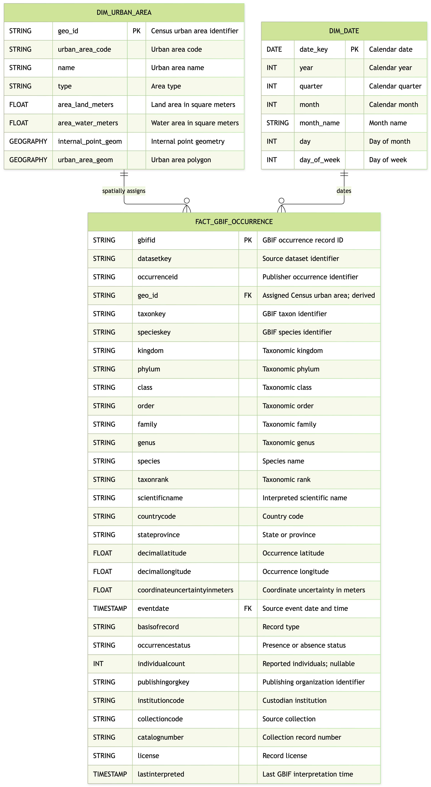

# P1 — Grain, Model, History & Pipeline Plan

## 1. Establish the question and check the source

### Audience, need, and analytical question

This product would be valuable for conservationists and urban planners looking to restore natural pockets of biodiversity within urban areas. 

A problem this audience might face is not being able to connect their jurisdiction to large-scale and current biodiversity study data. This product could bridge a gap between large biodiversity datasets and the local planners who are deciding conservation strategies. It’s possible a tool like this could lead to better focused choices that promote greater biodiversity.

The primary analytical question this model seeks to answer is:
- What species observations have been made within urban areas over time?
An specific supporting question that this model would support is:
- What are the 50 least observed species in Chicago, IL?

### P0 changes and feedback addressed

The primary change I've made based on P0 feedback is to the scope of analytical questions. I will be focusing the product on recorded observations rather than claims of population decline or migration priority. 

### Source profile

#### GBIF Biodiversity Data
| Item | Source-supported finding |
|:---:|:---:|
| Source object(s) | BigQuery gbif public dataset's occurrences table |
| BigQuery identifier(s) | bigquery-public-data.gbif.occurrences |
| Source row meaning | One row is one species identification observation - evidence of the occurrence of a species (or other taxon) at a particular place on a specified date. |
| Row count | 3,729,438,201 |
| Date coverage | 1500-01-01 00:00:00 UTC to 2026-08-28 00:08:00 UTC |
| Candidate fact identifier | gbifid |
| Relevant limitation | This table is a combination of many different datasets, from historic museum observations to citizen science apps, so the thoroughness, completion, and accuracy may vary widely within the dataset. Inconsistencies may come up with aggregations that include different origin datasets. Additionally, if the table is limited to one public reporting set, it's still likely that observer effort will distort occurrence counts. |

#### Census Urban Areas
| Item | Source-supported finding |
|:---:|:---:|
| Source object(s) | BigQuery geo_us_boundaries dataset's urban_areas table |
| BigQuery identifier(s) | bigquery-public-data.geo_us_boundaries.urban_areas |
| Source row meaning | One row represents one polygon around an urban area in the US |
| Row count | 3,601 |
| Date Coverage | no date/time data provided |
| Candidate fact identifier | geo_id |
| Relevant limitation | I will need to explore the geo capabilities of BigQuery to see if these geo columns can be used with the other dataset’s coordinate points |

### Proposed grain and observed check

Profiling SQL: [`sql/p1_source_profile.sql`](../sql/p1_source_profile.sql)

#### GBIF Biodiversity Data
**Proposed grain:** One row is one species identification observation - evidence of the occurrence of a species (or other taxon) at a particular place on a specified date.

**Expected counts:** 3,729,438,201

**Observed counts:** 3729438201

**Conclusion:** The gbifid is the key for the gbif table. I investigated a possible combination of the taxonkey, decimallatitude, decimallongitude, eventdate, collectioncode, catalognumber columns to try to define what composes the grain of the raw data further. These were the results:
| source_rows | rows_with_null_key_component | repeated_key_groups |
|:-----------:|:----------------------------:|:-------------------:|
| 3729438201  | 1372949073                   | 4002218             |
Based on these results, I've concluded that it would be difficult to establish exactly what combination of observations composes the grain of the raw table, and the exact grain defining columns would be easier to determine after the raw data is processed further (eg. limiting countrycode = US, basisofrecord = HUMAN_OBSERVATION)

#### Census Urban Areas
**Proposed grain:** One row represents one polygon around an urban area in the US.

**Expected counts:** 3,601

**Observed counts:** 3601

**Conclusion:** Aggregate functions can't be performed on geometry columns, but using urban_area_code as a proxy for urban_area_geom shows that there are the same non_null code entries as there are table rows.

#### Comments on grain and linking these datasets
The census urban area table was last updated in 2019, so it is safe to assume these urban boundaries are based on the 2010 census. According to the [2010 Census Urban and Rural Classification and Urban Area Criteria](https://www.census.gov/programs-surveys/geography/guidance/geo-areas/urban-rural/2010-urban-rural.html) the urban area shapes follow certain rules to ensure the boundaries are mutually exclusive, don't intersect with any other urban area, and are merged into one area if territories touch. Based on this information, it would be appropriate to say that one species observation's geographic point should only correspond to one urban area, if any.

## 2. Define the model and predict a history consequence

### Business process, fact type, and grain

The business process would be species observations made in urban areas. This model's fact table is a transaction type because each observation is recorded as it occurs. The model grain is one row represents one observation (gbifid) made in the United States within the last five years.

I will be choosing the biodiversity data set to be the central fact table. I will be limiting the biodiversity data to that within the U.S. in the last five years. This biodiversity data will then connect to the urban area table through a spatial relationship and assign an urban area code to the fact table during processing.

### Model diagram

### Question-to-model mapping

The primary analytical question—“What species observations have been made within urban areas over time" is answered by the FACT_GBIF_OCCURRENCE fact table, which contains one row per GBIF occurrence record identified by gbifid. Through this fact table, we can take a count of occurrence records and the count of distinct recorded species using specieskey. Taxonomic attributes such as species, genus, family, and kingdom will support species-level analysis and taxonomic filtering.

The DIM_URBAN_AREA dimension provides the urban-area name and geographic boundary. GBIF occurrence coordinates will be spatially joined to the Census urban-area polygons to assign observations to urban areas. 

The DIM_DATE dimension will provide calendar attributes derived from eventdate, allowing results to be grouped by year or month.

Filters on the data will restrict observations to the selected five-year period and U.S. study area, with an urban-area assignment for analyses comparing urban locations.

### Changing attributes and history

One value that may change over time with new census data would be the boundaries of urban areas. Changes to the urban_area_geom column may affect urban/rural the categorization of a historic observation. This would be a type 2 "meaningful" change and would require some type of version retention to be able to maintain the observation's urban categorization at the time of observation.

I'd propose a version_key column be added to the DIM_URBAN_AREA table which would be a compound of the geo_id with the census year (e.g. Phoenix-Mesa would be 69184.2010 ) and add an effective date range. This version_key is added to the FACT_GBIF_OCCURRENCE table to maintain the historic urban designation of the location of a species observation. The geo_id would still be the location's primary identifier - Phoenix_Mesa could still be found under 69184 through the years - but the version_key would become the DIM_URBAN_AREA table's new primary key.

### Behavior to implement or test by P3

The U.S. Census has published the 2020 urban area shape files. To test versioning and history, I could try to load the new shape file into my DIM_URBAN_AREA table following the versioning rules and see if it's effective date range changes the categorization of any observations. I noticed the Census Bureau also has already published corrections for Atlanta's 2020 boundaries. This could be used to test implementing type 1 corrections on this data set.

[Link to the most recent census data](https://www.census.gov/programs-surveys/geography/guidance/geo-areas/urban-rural.html)

## 3. Plan the build and its checks

### Raw, Curated, and Serving layers

| Layer | Planned object | Responsibility |
|:---:|:---:|:---:|
| Raw | raw_gbif_occurrences | Preserve source data as appropriate |
| Raw | raw_census_urban_areas | Preserve source data as appropriate |
| Curated | To be defined | Apply documented transformations and quality rules |
| Curated | To be defined | Apply documented transformations and quality rules |
| Serving | To be defined | Support the primary audience question |

### Preliminary run order and field path

[Trace one important field or measure from source to audience output.]

### Project risks and planned checks

| Risk | Planned check | Expected result | Layer or query |
|---|---|---|---|
| Grain or relationship risk | To be defined | To be defined | To be assigned |
| Audience-result meaning risk | To be defined | To be defined | To be assigned |

### Access and stewardship

[Identify the intended user, owner or steward, field sensitivity,
and access decision.]

### Largest limitation and first P2 step

[Document the largest remaining limitation and first concrete build step.]

## 4. Diagnose and revise the plan

### Peer feedback and change memo

**Changes Implemented:**
- Update the model diagram to account for the proposed urban area version history.
- Test geographic merge on subset of the data.

**Changes Not Adopted:**
- 

**Uncertainty:**
- 

### AI and tool-use note

